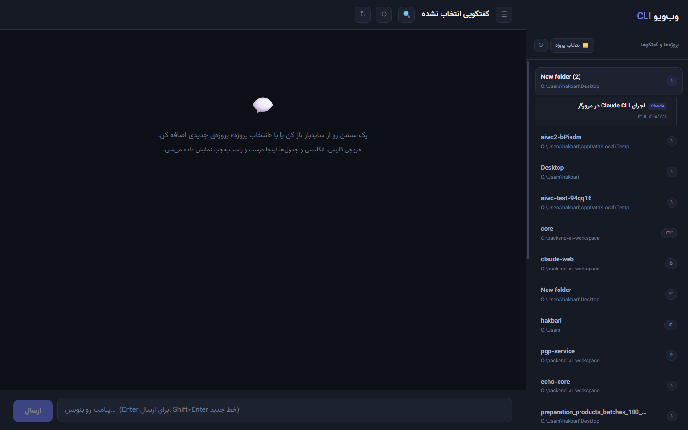

# AI Web Console

**Run [Claude Code CLI](https://claude.com/claude-code) and [OpenAI Codex CLI](https://developers.openai.com/codex/cli/) right inside your browser — with a beautiful Persian (RTL) interface that renders mixed Persian/English text flawlessly.**

[](LICENSE)
[](package.json)
[](#)
[](#)



> فارسی: این پروژه یک رابط وب برای اجرای Claude Code و Codex در مرورگر است، با پشتیبانی کامل فارسی. راهنمای فارسی در انتهای همین فایل آمده است.

## ✨ Features

- **Real session discovery** — picks up your *actual* Claude and Codex sessions from disk (`~/.claude/projects`, `~/.codex/sessions`), including ones created from a regular terminal
- **Background turns** — switching conversations never interrupts a running turn; messages sent while busy go to an editable queue
- **Stop button** that actually kills the running CLI process
- **Session forking** — branch a conversation down to a specific reply
- **Transcript search** across all sessions, with Farsi/Arabic normalization (ي→ی, ك→ک, diacritics, ZWNJ)
- **Live Codex model catalog** discovered from `codex app-server`, with per-conversation model & reasoning-effort selection
- **Token usage & context stats** — context window %, cache-read vs. fresh tokens, per-turn usage
- **Perfect bidirectional text** — each paragraph's direction is detected independently; code blocks are always LTR; tables handle mixed RTL/LTR cells
- **Custom launcher mirroring** — if your `~/.codex/config.toml` defines a `proxy` provider (e.g. you launch Codex via a custom alias), the console mirrors it automatically — no config changes needed
- **100% local** — binds to `127.0.0.1` only; uses your existing CLI logins and config as-is. No cloud, no CDN (Vazirmatn font is bundled)

## 🚀 Quick Start

```bash
git clone https://github.com/hakbari435/ai-web-console.git
cd ai-web-console
npm install
npm start        # → http://127.0.0.1:3000
```

On Windows: just double-click **`run.bat`** (and **`off.bat`** to stop).

**Prerequisites:** Node.js 18+, and `claude` and/or `codex` on your PATH, logged in.

## ⚙️ Configuration

Everything works out of the box with your system's CLI config. To customize, copy `.env.example` to `.env` and uncomment what you need — empty values always fall back to system defaults:

| Key | Default | Purpose |
|---|---|---|
| `HOST` / `PORT` | `127.0.0.1` / `3000` | Server bind address |
| `WORKDIR` | home dir | Default working folder for new conversations |
| `CLAUDE_CMD` / `CODEX_CMD` | `claude` / `codex` | CLI executables |
| `CLAUDE_PERMISSION_MODE` | `acceptEdits` | Claude permission mode |
| `CLAUDE_SKIP_PERMISSIONS` | `0` | `1` = no permission prompts at all (dangerous) |
| `CODEX_SANDBOX` | `workspace-write` | Codex sandbox mode |
| `CODEX_BYPASS` | `0` | `1` = no sandbox/approvals (dangerous) |
| `CODEX_EXEC_PREFIX_ARGS` | *(auto)* | Args injected before `exec`; auto-mirrors a `proxy` provider from `config.toml` |
| `PROXY_API_KEY` | — | Env key forwarded to Codex for custom launchers |

## 🏗️ Architecture

```
server/                    Node.js + Express + WebSocket
├── index.js               REST API + global WS endpoint
├── manager.js             background turns, queue, event fan-out
├── adapters/
│   ├── claude.js          one `claude --print --output-format stream-json` per turn
│   └── codex.js           one `codex exec --json` per turn (resume / fork-aware)
├── discovery.js           JSONL transcript parsing, usage stats, byte-level fork
├── transcriptSearch.js    normalized full-text search
├── codexCatalog.js        live model discovery via `codex app-server`
└── stores…                sessions.json / overrides.json / models.json (atomic writes)

public/                    dependency-free UI (built-in markdown renderer, local fonts)
```

The CLIs' own session files are the single source of truth — history is re-read fresh from disk on every conversation open, so changes made from any terminal are always reflected.

## 🧪 Tests

```bash
node test-e2e.mjs     # real Claude turn end-to-end: conversation → reply → history → search
node test-stop.mjs    # stop-button behavior
```

## 📄 License

[MIT](LICENSE)

---

## راهنمای فارسی (Persian Guide)

یک وب‌اپ محلی برای اجرای **Claude Code** و **Codex** در مرورگر:

1. **`run.bat`** را دابل‌کلیک کنید (برای توقف: `off.bat`)
2. مرورگر روی `http://127.0.0.1:3000` باز می‌شود
3. با «انتخاب پروژه» پوشه‌ی کاری را انتخاب کنید و گفتگو شروع کنید

همه‌چیز از کانفیگ خود سیستم خوانده می‌شود (لاگین Claude، `~/.codex/config.toml` و لانچر سفارشی مثل `codexx`). برای تنظیمات دلخواه، فایل `.env.example` را به `.env` تغییر نام دهید.

**Keywords:** claude code web ui · codex cli web interface · claude cli browser · persian ai terminal · farsi rtl chat · ترمینال تحت وب هوش مصنوعی · اجرای کلاد در مرورگر · رابط فارسی claude · codex فارسی
